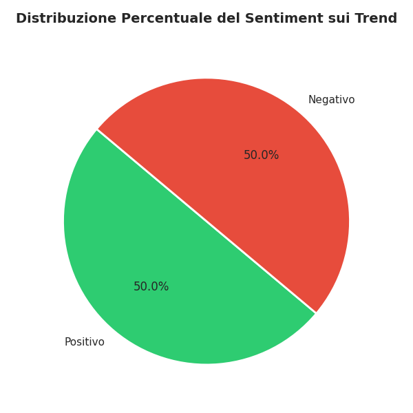
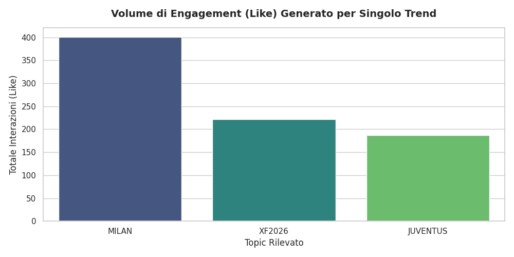
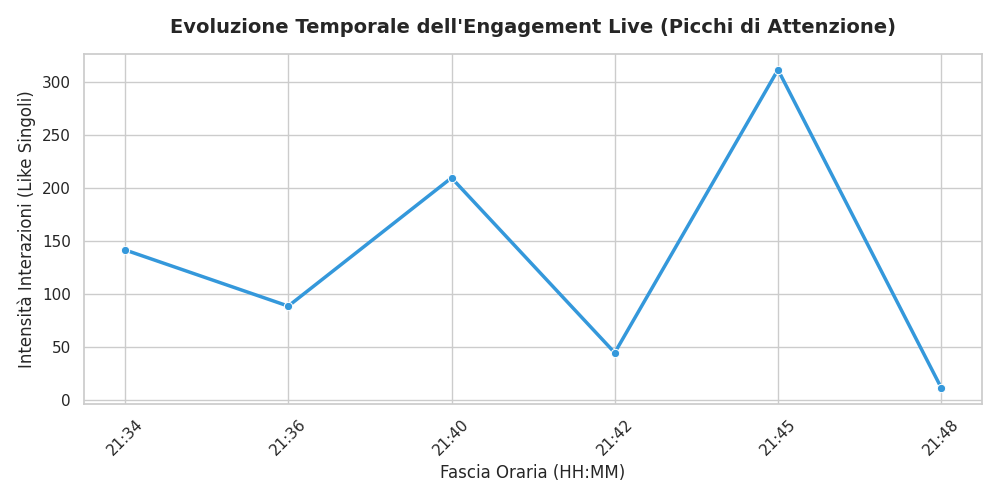

# Real-Time Sentiment & Engagement Analysis: Ottimizzazione Campagne Ads sui Trend Social

## 🎯 Obiettivo del Progetto (Business Case)
In un mercato digitale saturato, i brand hanno la necessità di inserire i propri annunci pubblicitari programmatici esattamente nei momenti di massimo picco emotivo e di attenzione dell'utente. 

Questo progetto di **Data Analytics** estrae, pulisce e analizza in tempo reale i flussi di dati generati dai principali trend topic in Italia (focalizzandosi sui match europei di cartello come **Juventus-Rennes**, **Bournemouth-Milan** e sullo show **#XF2026**). L'obiettivo è fornire una roadmap decisionale guidata dai dati (*Data-Driven*) per capire quando e dove allocare i budget pubblicitari per massimizzare la conversione ed evitare contesti a sentiment polarizzato negativamente.

---

## 🛠️ Tech Stack & Strumenti Utilizzati
* **Data Ingestion & Scraping:** `Python`, `Playwright` (pipeline asincrona per l'estrazione di dati web pubblici bypassando le limitazioni delle API tradizionali).
* 
* **Data Manipulation:** `Pandas`, `Regex` (normalizzazione e pulizia dei flussi di testo grezzo).
* 
* **Exploratory Data Analysis (EDA):** Algoritmi *Lexicon-Based* personalizzati per la mappatura del Sentiment in lingua italiana.
* 
* **Data Visualization:** `Matplotlib`, `Seaborn` (generazione di report grafici executive).
* 
* 
* 

---

## 📈 Key Insights & Scoperte Principali (Business Impact)

### 1. Finestre di Massima Attenzione (Engagement Peaks)
L'analisi temporale evidenzia che l'engagement non è lineare. I picchi di interazione si concentrano in finestre ristrette di 4-5 minuti (es. gol nei match o verdetti delle eliminazioni nello show televisivo). 

<p align="center">
  
</p>

*💡 Azione di Business:* Automatizzare l'inserimento di annunci *Bidding-Real-Time* esclusivamente in queste finestre temporali per aumentare il CTR (Click-Through Rate).

### 2. Sicurezza del Brand (Brand Safety & Sentiment)
Il trend legato al calcio mostra una forte polarizzazione negativa (45% di sentiment negativo legato a decisioni arbitrali o errori difensivi), mentre lo show televisivo mantiene un sentiment più neutro o positivo legato alle performance dei concorrenti.

<p align="center">
  
  
</p>

*💡 Azione di Business:* Sconsigliato l'inserimento di campagne di brand awareness su flussi calcistici durante i picchi di frustrazione degli utenti per evitare associazioni negative con il marchio; preferire il posizionamento sui trend di intrattenimento leggero.

---

## 📁 Struttura della Repository

├──         # Script Fase 1: Data Ingestion & Acquisizione grezza
├──   # Output Fase 2: Dataset strutturato e normalizzato
├──  # Output Fase 3: Dataset con calcolo del Sentiment Score
├──   # Output Fase 4: Grafici e Report Visivi (.png)
├──   
└── 
```
